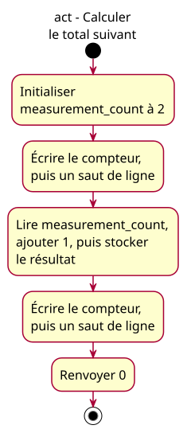

# ACT-arithmetic-update - arithmetic update lesson

## Context

Owner-approved realization for [issue #23](https://github.com/benoit-bremaud/cpp-learning-course/issues/23), governed by the [accepted lesson specification](../../specs/arithmetic-update-lesson.md). Status: conception A and its concrete local implementation plan explicitly approved by the owner on 2026-10-26. Separate conception publication/merge must precede implementation; this model authorizes no push, PR, merge or deletion.

## Notes

The single update action reads the old value 2, computes 3 and replaces the stored value. Those conceptual substeps belong to one C++ assignment statement, not three source instructions. This is one explicit update, not a loop, physical event or sensor acquisition.

Five conceptual actions cover seven body statements: initialization, two writes, update, two writes and return. Include, main signature, braces and initial/final nodes are structural. Each observation groups value and newline statements. Output and process status stay distinct.

One initial node and one activity final, sequential control flow, no decision, merge, fork, lifecycle, actor-goal collaboration or infrastructure boundary. Activity is the only justified UML type. French 16px labels and ASCII hyphens. The .puml source is authoritative; regenerate rather than editing SVG geometry.
