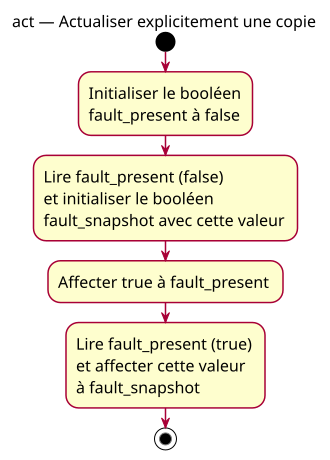

# Activity — refresh

Source: [Boolean values specification](../../specs/boolean-values.md).

## Context

Owner-approved scenario refresh: represent an explicitly supplied fault report using bool values. This activity models assignments, not detection, repair, display or branching.

## Diagram

## Notes

Names, boolean values and action order match the associated snippet. The final node ends the fragment without adding return. No physical input, output, invented temporary or decision node is modeled. The absent model is also the expected conception for the wrong initial-value example, whose discrepancy must be explicit.
