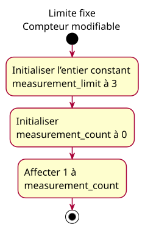

# Activity — Stable limit and mutable count

## Context

Source: [constant-limit conception](../../specs/constant-limit.md), CL-01. Approved by the owner before implementation. French teaching labels preserve English code identifiers.

## Diagram

## Notes

Only the valid primary example is modeled as executable behavior. CL-02 violates the constant invariant and fails compilation; CL-03 deliberately diverges at the initial value. Neither is presented as a conforming realization of this activity. No sensor, storage allocation or enforcement of capacity is modeled.
