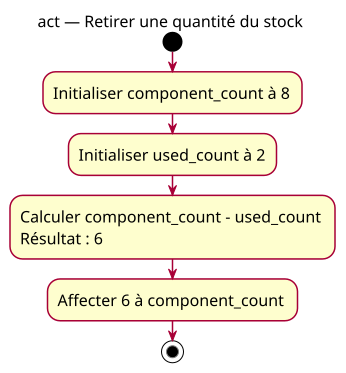

# Activity — withdrawal

Source: [Counter update specification](../../specs/counter-update.md).

## Context

Owner-approved scenario withdrawal: follow the current value through explicit assignments. This is a sequential fragment, not event detection or a loop.

## Diagram

## Notes

Calculation and storage are conceptual steps within one assignment, not additional C++ variables or processor instructions. The final node ends the fragment without adding a return. The repeated model also supplies the expected conception for the deliberately faulty reset snippet; that discrepancy must be explicit in its card.
