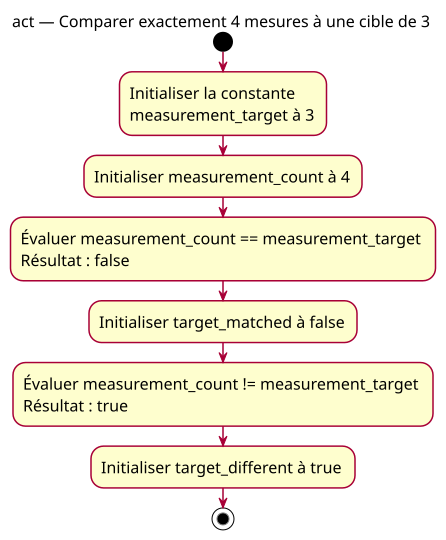

# Activity — above

Source: [Exact equality proposal](../../specs/equality-comparisons.md).

## Context

Owner-approved conception: exact equality and difference on two supplied integers. Expected pair: false/true. No acquisition, decision path or automatic action.

## Diagram

## Notes

Evaluation and storage actions describe two declarations without extra temporary variables. All names match the specification. This is also the intended model for the deliberately faulty >= example; actual true/true must be labeled separately.
