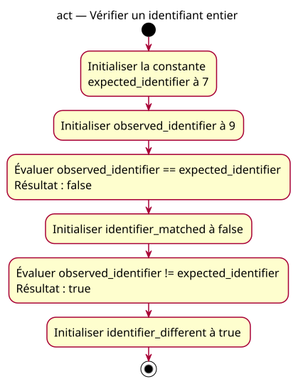

# Activity — identifier

Source: [Exact equality proposal](../../specs/equality-comparisons.md).

## Context

Proposed conception: exact equality and difference on two supplied integers. Expected pair: false/true. No acquisition, decision path or automatic action.

## Diagram

## Notes

Evaluation and storage actions describe two declarations without extra temporary variables. All names match the specification. Both input values remain unchanged.
