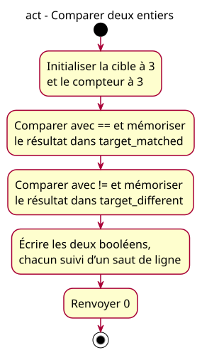

# ACT-equality-pair - Comparer deux entiers

## Context

Owner-approved equality-results conception A for issue26, accepted on2026-10-27. [Source contract](../../specs/equality-results-lesson.md). This activity answers which actions occur in order in one hosted execution. It does not select paths: equality computes a Boolean result, not a control-flow decision. A single initial node and activity final delimit the whole execution.

## Notes

Authoritative source: [PlantUML](07-activity-equality-pair.puml), generated headlessly with defaultFontSize16. French labels follow the teaching-content exception; engineering prose remains English. Five actions map nine statements. Initial target/count share one action; the observation groups four writes. Main signature, inclusion, braces and initial/final nodes are structural, not invented executable statements.

No decision, merge, fork, actor, hardware event or autonomous observation is modeled. Sequence/component/class/state/data-flow/deployment diagrams add no question needed by this static lesson and are omitted proportionately. The public snapshot and card are future implementation, not present delivery.
