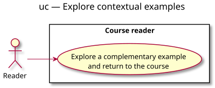

# Use-case diagram — Example explorer

## Context

This view identifies the reader's observable goal without describing UI components. Source: [example explorer specification](../../specs/example-explorer.md). Requirements: [site-wide charter](../../../example-charter.md).

## Diagram

## Notes

- The reader initiates the goal and returns to the same course position.
- Tabs, selectors and dialogs are realization details defined in the specification, not separate user goals.
- Implementation remains a separately reviewed change.
