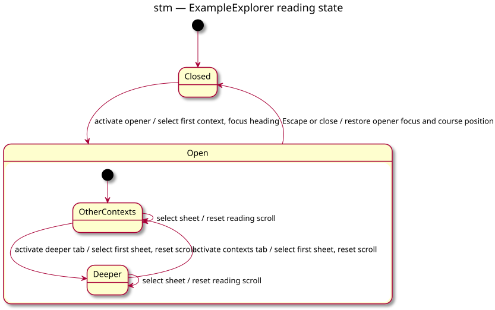

# State-machine diagram — Example explorer dialog

## Context

This view defines the reader-visible navigation state and restoration behavior of one explorer instance. Source: [example explorer specification](../../specs/example-explorer.md). Requirements: [site-wide charter](../../../example-charter.md).

## Diagram

## Notes

- Opening always selects the first context and starts its reading area at the top.
- Switching categories or sheets resets only the supplemental reading position.
- Closing restores focus and the course position; no selection persists between openings.
