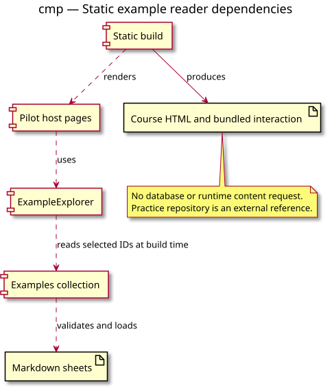

# Component diagram — Static example explorer

## Context

This view makes build-time ownership and dependency direction explicit. Source: [example explorer specification](../../specs/example-explorer.md). Requirements: [site-wide charter](../../../example-charter.md).

## Diagram

## Notes

- Markdown sheets own teaching content; the collection validates metadata.
- Host pages select content and the shared component renders it during the static build.
- Generated pages make no runtime teaching-content request and require no database.
