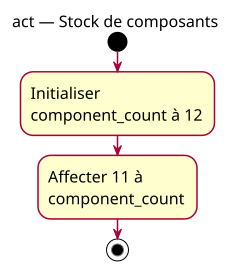

# Activity diagram — Replace a component count

## Context

This activity isolates assignment as replacement of an integer value. Source: [example explorer specification](../../specs/example-explorer.md) § P1. Requirements: [site-wide charter](../../../example-charter.md).

## Diagram

## Notes

- `component_count` is observable as 12 after initialization and 11 after assignment.
- The second action does not imply subtraction or a sensor reading.
- Arithmetic, input and hardware behavior remain outside this example.
