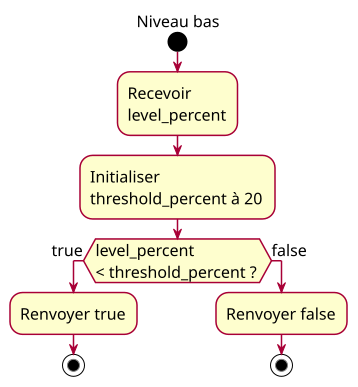

# 06-activity-reservoir — Example explorer

## Context

Accepted conception for a separately reviewed implementation. Source: [example explorer specification](../../specs/example-explorer.md). Requirements: [site-wide charter](../../../example-charter.md).

## Diagram

## Notes

The specification defines contracts, boundaries and verification. Implementation must follow the approved specification. Teaching activity sources are accepted design inputs; final practice source ownership follows the specification. No class or sequence view is added: the simple reading flow and scalar examples do not require those views.
