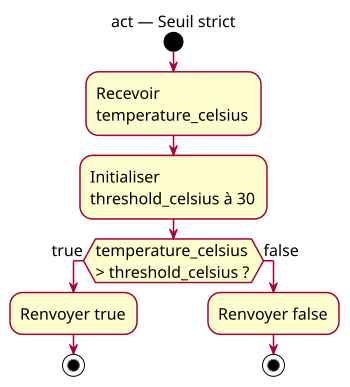

# Activity diagram — Apply a strict temperature threshold

## Context

This activity preserves the published rule that the indicator activates only above 30 °C. Source: [example explorer specification](../../specs/example-explorer.md) § P4. Requirements: [site-wide charter](../../../example-charter.md).

## Diagram

## Notes

- Temperatures 29 and 30 return `false`; 31 returns `true`.
- Equality is excluded intentionally by the strict requirement.
- This activity remains distinct from the inclusive alternative.
