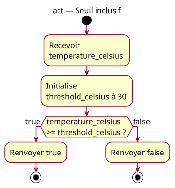

# 08-activity-inclusive — Example explorer

## Context

Conception explicitly approved by the owner before implementation. Source: [example explorer specification](../../specs/example-explorer.md). Requirements: [site-wide charter](../../../example-charter.md).

## Diagram

## Notes

The specification defines contracts, boundaries and verification. The local implementation follows the approved specification. Teaching activity sources are review drafts; final practice source ownership follows the specification. No class or sequence view is added: the simple reading flow and scalar examples do not require those views.
