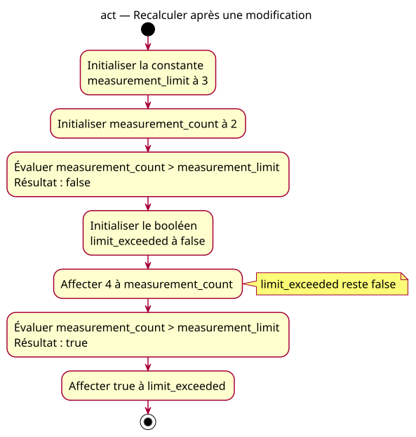

# Activity — refresh

Source: [First comparison proposal](../../specs/first-comparison.md).

## Context

Owner-approved conception: calculate whether a supplied measurement count strictly exceeds a fixed fictional limit. No enforcement or hardware acquisition takes place.

## Diagram

## Notes

The comparison yields a bool; it does not select a control-flow path, so no decision diamond is needed. Conceptual evaluation/storage actions do not introduce code temporaries or processor instructions. The above model also serves as the expected reference for the deliberately reversed-operand example, not as a trace of its faulty execution.
