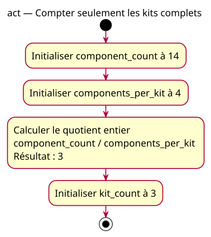

# Activity — Compter seulement les kits complets

Source: [First integer division](../../specs/first-divisions.md).

## Context

Owner-approved conception: known stock and four components per kit. Compute possible complete kits without modifying stock or assembling hardware.

## Diagram

## Notes

The divisor is positive by precondition, not by a code guard. Calculation/storage separation is conceptual. No remainder variable, stdout, implicit return or invalid execution is modeled.
