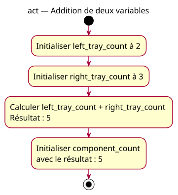

# Activity — Addition de deux variables

Source specification: [First expressions](../../specs/first-expressions.md).

## Context

Owner-approved teaching fragment. Calculation and storage are conceptual actions, not a promise about machine instructions or temporary variables.

## Diagram

## Notes

The final node ends the fragment. No output, hardware operation or return statement is implied. Inputs are small integer counts; this diagram does not validate external input.
