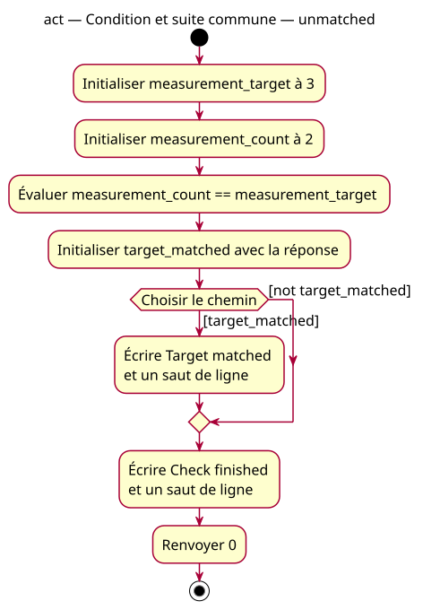

# Activity — first if — unmatched

Source: [First if proposal](../../specs/first-if.md).

## Context

Proposed conception: inspect a stored bool, execute or skip a message, then continue with the common write and return. Both paths remain modeled for the concrete supplied initializer.

## Diagram

## Notes

Guard not is UML predicate notation, not C++ syntax. Guards are complementary, so exactly one path is selected. The empty false path merges before the common write; no parallel execution or synchronization. This model is also the expected design for the misplaced-statement discrepancy.
