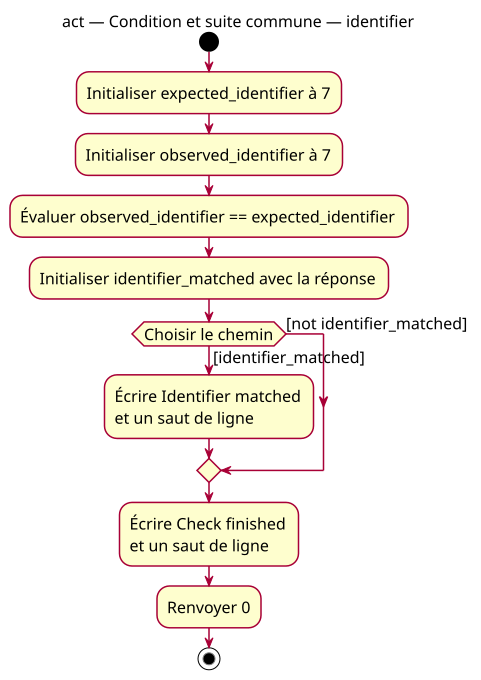

# Activity — first if — identifier

Source: [First if proposal](../../specs/first-if.md).

## Context

Owner-approved conception: inspect a stored bool, execute or skip a message, then continue with the common write and return. Both paths remain modeled for the concrete supplied initializer.

## Diagram

## Notes

Guard not is used here as a UML predicate; no negation is added to the teaching programs. Guards are complementary, so exactly one path is selected. The empty false path merges before the common write; no parallel execution or synchronization. The comparison is evaluated once before reading its stored result.
