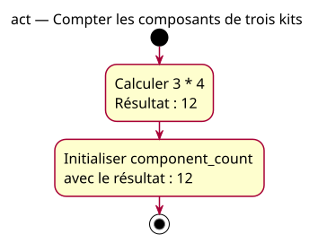

# Activity — Compter les composants de trois kits

Source specification: [First multiplication](../../specs/first-multiplications.md).

## Context

Owner-approved equal-size-kit conception. Known counts; no hardware operation or input validation.

## Diagram

## Notes

Calculation and storage are conceptual actions. Inputs remain unchanged. The named model is the expected reference for the wrong-addition case, not its executed trace. No required machine instruction sequence or console output is implied.
