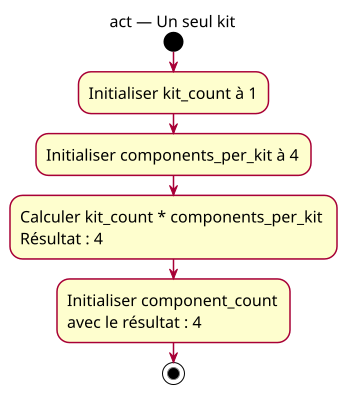

# Activity — one kit

Source specification: [First multiplication](../../specs/first-multiplications.md), M5.

## Context

Proposed contrast after the named three-kit example: only kit_count changes. The product equals the per-kit quantity; multiplication does not always increase that value.

## Diagram

## Notes

Approved by the owner. Calculation/storage actions describe conceptual reasoning, not machine instructions. Inputs remain unchanged; no output or physical assembly is implied.
