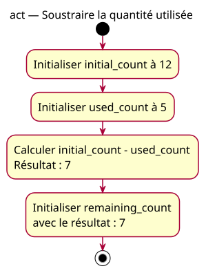

# Activity — Soustraire la quantité utilisée

Source specification: [First subtraction](../../specs/first-subtractions.md).

## Context

Owner-approved conception. Model the expected remaining stock, with known quantities and no hardware operation.

## Diagram

## Notes

Calculation and storage are conceptual actions, not separate required C++ instructions. Inputs remain unchanged; no console output or input guard is implied. The named activity is also the expected reference for the deliberately reversed formula, not a depiction of its actual execution.
