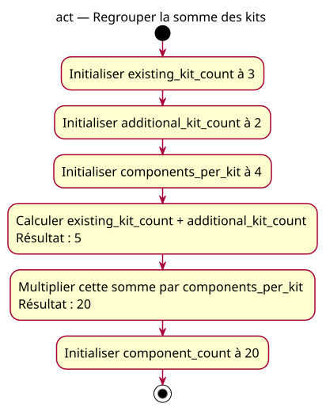

# Activity — Regrouper la somme des kits

Source: [Grouped calculations](../../specs/grouped-calculations.md).

## Context

Owner-approved conception. Same requirement: five kits of four components. Conceptual data dependencies, not a CPU execution schedule.

## Diagram

## Notes

Only the explicit-intermediate variant declares total_kit_count. The grouped model is the expected reference for faulty formulas, never their executed trace. No IO, input guard or implicit return.
