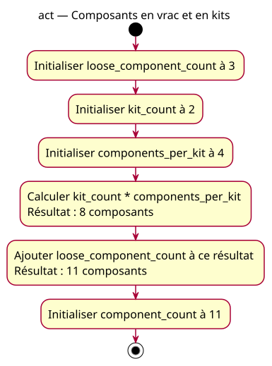

# Activity — loose components plus kit contents

Source: [Grouped calculations](../../specs/grouped-calculations.md), G5.

## Context

Owner-approved transfer case: three loose components and two kits of four. This is a different requirement from five kits, so eleven is correct here.

## Diagram

## Notes

Arithmetic dependencies are conceptual, not an instruction schedule. No fictitious named intermediate, IO, input guard or implicit return. All initialized input variables retain their values.
