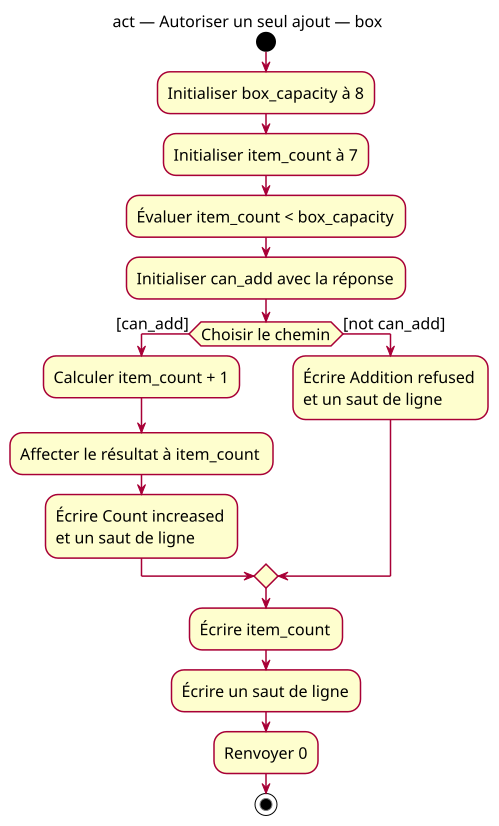

# box activity

## Context

[Specification](../../specs/guarded-increment.md). One decision, at most one increment. Both alternatives remain shown; only one is traversed. can_add retains its pre-operation value. No automatic repair or repeated evaluation is modeled.

## Notes

[PlantUML source](04-activity-box.puml). Calculation and assignment are consecutive steps of one C++ assignment; no extra variable is introduced. Includes are compile-time context.
