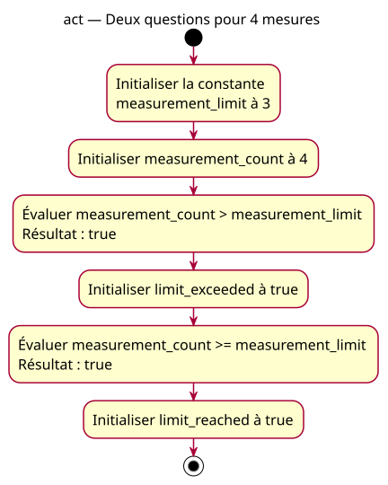

# Activity — above

Source: [Inclusive comparison proposal](../../specs/inclusive-comparison.md).

## Context

Owner-approved conception. Ask two distinct questions of the same supplied count: strict exceedance and reaching or exceeding the limit. The count is 4, the limit is three.

## Diagram

## Notes

limit_reached explicitly means at least the limit, not exact equality. Sequential evaluation/storage steps correspond to two bool declarations; no branching, enforcement or hardware action is modeled. The equal model is also the expected conception for two deliberately faulty operator substitutions, whose cards must state their actual results separately.
