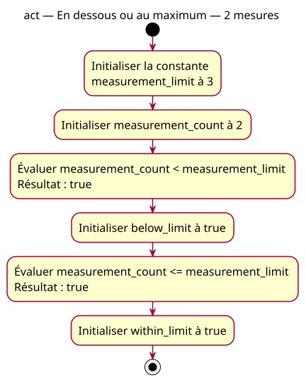

# Activity — below

Source: [Lower comparisons proposal](../../specs/lower-comparisons.md).

## Context

Owner-approved conception. Two questions of the same supplied count: strictly below the maximum and at most the maximum. The count is 2 and the maximum is three.

## Diagram

## Notes

The actions preserve exact code names. Evaluation and storage correspond to the two declarations, not extra variables. No branching, physical detection or enforcement. This also supplies the expected conception for the reversed-operand example; its actual false/true result must be labeled separately.
