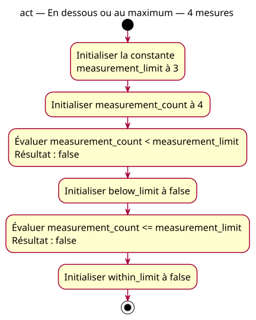

# Activity — above

Source: [Lower comparisons proposal](../../specs/lower-comparisons.md).

## Context

Owner-approved conception. Two questions of the same supplied count: strictly below the maximum and at most the maximum. The count is 4 and the maximum is three.

## Diagram

## Notes

The actions preserve exact code names. Evaluation and storage correspond to the two declarations, not extra variables. No branching, physical detection or enforcement. Both numeric inputs remain unchanged.
