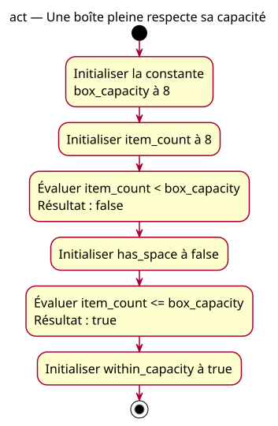

# Activity — capacity

Source: [Lower comparisons proposal](../../specs/lower-comparisons.md).

## Context

Proposed conception. Two questions of the same supplied count: strictly below the maximum and at most the maximum. The box is full; compliance with capacity does not imply space for another item.

## Diagram

## Notes

The actions preserve exact code names. Evaluation and storage correspond to the two declarations, not extra variables. No branching, physical detection or enforcement. Both numeric inputs remain unchanged.
