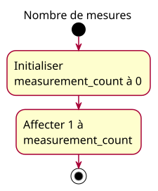

# Activity — Initialize and update the measurement count

## Context

Source: [measurement-count specification](../../specs/measurement-count.md), MC-02/03/05. This approved activity describes two straight-line operations, not event-driven acquisition. The owner validated this conception before implementation.

## Diagram

## Notes

Teaching labels use French under the approved French-course exception; the exact code identifier remains English. Observation notes are not extra executable actions. There is no sensor event, implicit waiting step or automatic increment. An activity is sufficient; class and sequence diagrams add no useful information here.
