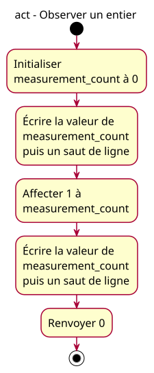

# Activity - observe initialization and assignment

## Context

Owner-approved option A of the [observable-variables specification](../../specs/observable-variables.md), issue [#16](https://github.com/benoit-bremaud/cpp-learning-course/issues/16). Question: which value does the same integer hold at each output checkpoint? The owner validated the conception and concrete plan on 2026-10-24; lesson implementation and publication remain separate.

## Notes

- Each observation groups two successive statements: output the integer's current value, then output a newline. The specification maps all seven actual statements to these five conceptual actions.
- Initialization establishes 0; assignment replaces it with the supplied total 1. No input, wait, acquisition or addition is modeled. Output does not modify the integer.
- Initial/final nodes and main's structural syntax are not additional C++ statements. Return status 0 does not print another number.
- The original [two-action fragment activity](01-activity-update.md) is a historical narrower view. It is not the exact executable model of the proposed complete program.
- French labels use 16px type. Generated SVG bytes come from the adjacent PlantUML source, without manual geometry edits. No public snapshot or lesson change is part of this conception delivery.
