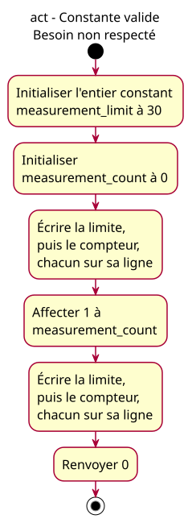

# ACT-wrong-limit - observable constant values

## Context

Proposed realization of [issue #20](https://github.com/benoit-bremaud/cpp-learning-course/issues/20) and the [observable-constants lesson specification](../../specs/observable-constants-lesson.md). Status: conception explicitly approved by the owner on 2026-10-26; publication remains separate. This is not a published lesson change.

## Notes

The activity begins at entry to main's body. The limit is initialized to 30; the ordinary count is initialized to 0, then assigned the supplied total 1. No acquisition, arithmetic or capacity enforcement occurs. Each pair observation groups four C++ statements: value/newline for the limit, then value/newline for the count. Six conceptual actions cover twelve statements. Include, signature and braces are structural.

This activity models the actual legal-but-wrong program, not the required value of 3. The first initialization is the exact divergence point; the constant remains 30.

One initial and one activity final node, sequential control flow, no decision, fork, object lifecycle, component collaboration or actor-goal view. Only an activity answers the present question. Sources and SVGs form one PlantUML triplet; render rather than editing SVG geometry. French labels, 16px font, ASCII hyphens in new text.
