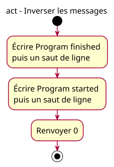

# Activity - reversed

Issue: [#13](https://github.com/benoit-bremaud/cpp-learning-course/issues/13). Source: [ordered-output specification](../../specs/ordered-output.md), OO-02. Status: conception explicitly approved by the owner on 2026-10-23; publication remains separately authorized.

## Context

Swap only the two writes; compare the intentionally different result. The activity starts inside main; runtime initialization and stream buffering are outside its scope.

## Diagram

## Notes

- Three actions map to two output statements then return 0 in the planned program-reversed excerpt.
- Initial/final nodes are not extra C++ statements; source layout does not itself request output newlines.
- Match exact text, case, spaces, newlines and action order against OO-02; stderr must be empty and exit status zero.
- French labels are teaching content. Generate the SVG from its puml source, never edit geometry manually.
