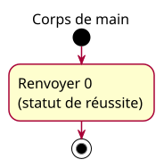

# Activity — Minimal main body

## Context

See [program skeleton specification](../../specs/program-skeleton.md). Proposed conception, pending owner approval.

## Diagram

## Notes

The activity begins at entry into this example's main body, not at physical processor startup. The single action corresponds to explicit return of zero. The final node marks termination of the activity, not a second code statement. Formatting variants share the same behavior. An isolated return fragment has no standalone successful program trace. No sequence/class/state diagram is warranted for this one-action example.
