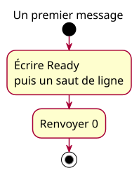

# Activity - Ready

Work item: [#10](https://github.com/benoit-bremaud/cpp-learning-course/issues/10). Source specification: [PS-01](../../specs/program-skeleton.md#two-contracts-and-proportional-models). Status: conception explicitly approved by the owner on 2026-10-22; publication remains separately authorized.

## Context

Model the first complete program inside main: write Ready and a newline, then return 0. Runtime initialization and termination internals are outside this activity.

## Diagram

## Notes

- The initial and final nodes are not extra C++ statements.
- Include directive, signature and braces are structural, not output actions.
- Two actions map to the two statements of `example:program-ready`; expected stdout is `Ready\n`, stderr is empty, exit status is 0 in the stated successful environment.
- French labels are teaching content. Generate SVG from ready.puml; never edit its geometry.
