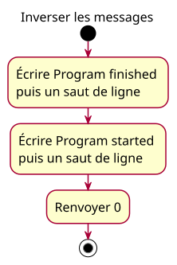

# Activity — reversed

See [accepted conception](../../specs/program-skeleton.md).

Entry is inside main. The action order and literal output match the labelled lesson program. Final node is not an extra instruction.
