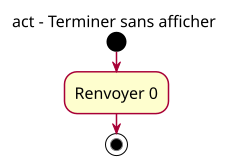

# Activity - Silent

Work item: [#10](https://github.com/benoit-bremaud/cpp-learning-course/issues/10). Source specification: [PS-02](../../specs/program-skeleton.md#two-contracts-and-proportional-models). Status: conception explicitly approved by the owner on 2026-10-22; publication remains separately authorized.

## Context

Model the comparison program inside main: return 0 without writing text. This is a valid complete program with a different output requirement.

## Diagram

## Notes

- One action maps to the single statement of `example:program-silent`.
- The initial and final nodes are modeling notation, not extra instructions.
- Expected stdout and stderr are empty, exit status is 0. Successful termination and visible output are distinct observations.
- French labels are teaching content. Generate SVG from silent.puml; never edit its geometry.
