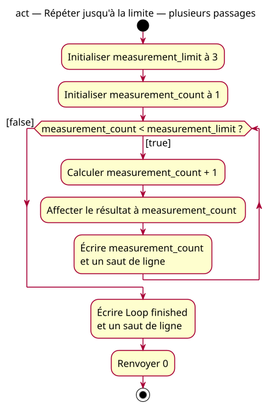

# Multiple-iteration activity

## Context

[Specification](../../specs/repeated-decision.md). Starting at 1 with limit 3 traverses the true path twice, then the false path once. The back edge means sequential re-evaluation, not parallel execution.

## Notes

[PlantUML source](01-activity-multiple.puml). Calculation and assignment are two conceptual steps of one C++ assignment; they do not imply an additional variable.
