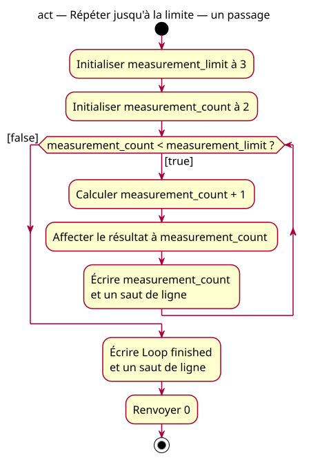

# One-iteration activity

## Context

[Specification](../../specs/repeated-decision.md). Starting at 2 makes the first decision true and the second false, so the body runs exactly once.

## Notes

[PlantUML source](02-activity-one.puml). The same structure as the multiple-iteration case is retained deliberately; only the supplied initial value changes.
