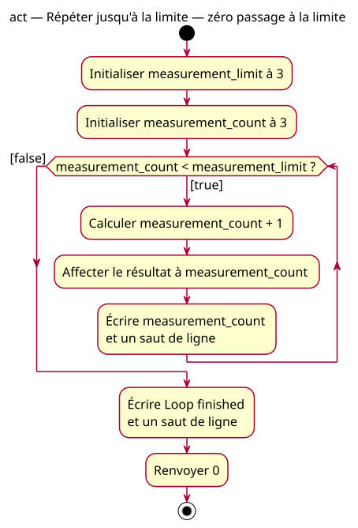

# Zero-iteration activity at the limit

## Context

[Specification](../../specs/repeated-decision.md). At 3 with limit 3, the initial decision is false. The body is never entered and the program continues after the loop.

## Notes

[PlantUML source](03-activity-zero-at-limit.puml). The unused true path remains visible because it is part of the program's possible behavior, even though this supplied value does not traverse it.
