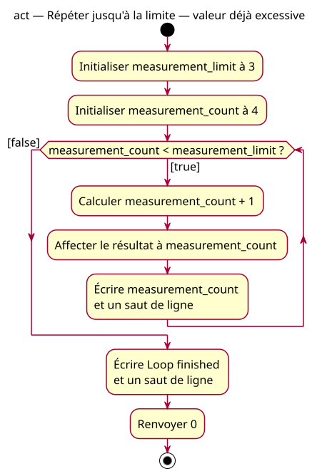

# Zero-iteration activity above the limit

## Context

[Specification](../../specs/repeated-decision.md). Starting at 4 with limit 3 follows the false path immediately. The loop prevents another update but does not repair the excessive input.

## Notes

[PlantUML source](04-activity-zero-above.puml). The neutral “Loop finished” literal avoids claiming that an initially excessive input equals the limit; lesson prose must still explain that it does not mean “input validated”.
