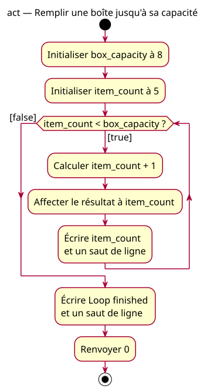

# Box-transfer activity

## Context

[Specification](../../specs/repeated-decision.md). Starting at 5 with capacity 8 traverses the body three times and prints 6, 7 and 8 before leaving the loop.

## Notes

[PlantUML source](05-activity-box.puml). The renamed values transfer the control rule only. No physical insertion, size, weight or sensor behavior is modeled.
