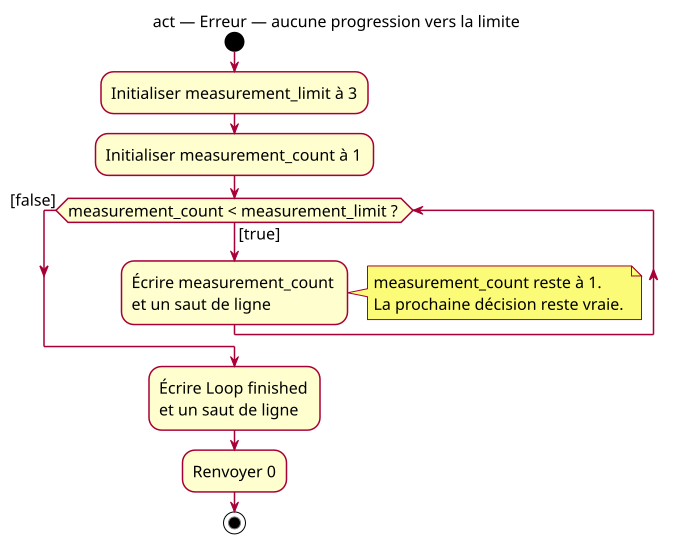

# Missing-update error activity

## Context

[Specification](../../specs/repeated-decision.md). This diagram models the actual faulty program. With the supplied count 1 and limit 3, the true path leaves both operands unchanged, so every later decision is true and the false path is unreachable during that execution.

## Notes

[PlantUML source](06-activity-missing-update.puml). The false path remains in the program model because other supplied values could take it. The lesson and tests must not run this exact supplied execution without a deterministic external guard.
