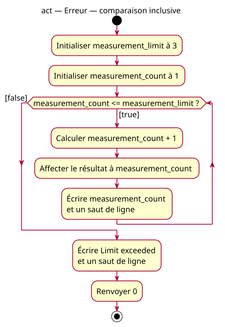

# Inclusive-condition error activity

## Context

[Specification](../../specs/repeated-decision.md). This is the actual faulty execution. Equality at count 3 still takes the true path, increments to 4 and only then makes the inclusive condition false.

## Notes

[PlantUML source](07-activity-inclusive-error.puml). The intended strict requirement is documented in the specification; this diagram deliberately preserves the erroneous `<=` guard so the code/UML discrepancy is not hidden.
