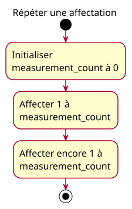

# Répéter une affectation

## Context

Approved teaching activity. See [focused conception](../../specs/repeated-assignment.md).

## Diagram

## Notes

Each action maps to one planned instruction. Lesson tables describe the checkpoints 0, 1, 1; observations are not extra operations. No acquisition, incrementing or automatic capacity enforcement occurs.
