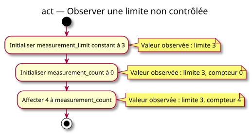

# Observer une limite non contrôlée

## Context

Proposed teaching activity. See [comparison contracts](../../specs/value-comparisons.md). Owner validation is pending.

## Diagram

## Notes

Each action maps to one planned instruction. Notes describe observations, not extra operations. No acquisition, incrementing or automatic capacity enforcement occurs.
