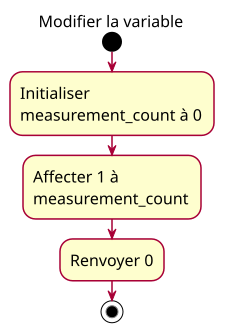

# Activity — Assignment within main

See [approved conception](../../specs/assignment-redeclaration.md).

The activity begins inside main. The invalid second definition is an implementation discrepancy, not an executed branch. The return status is separate from the local variable value.
