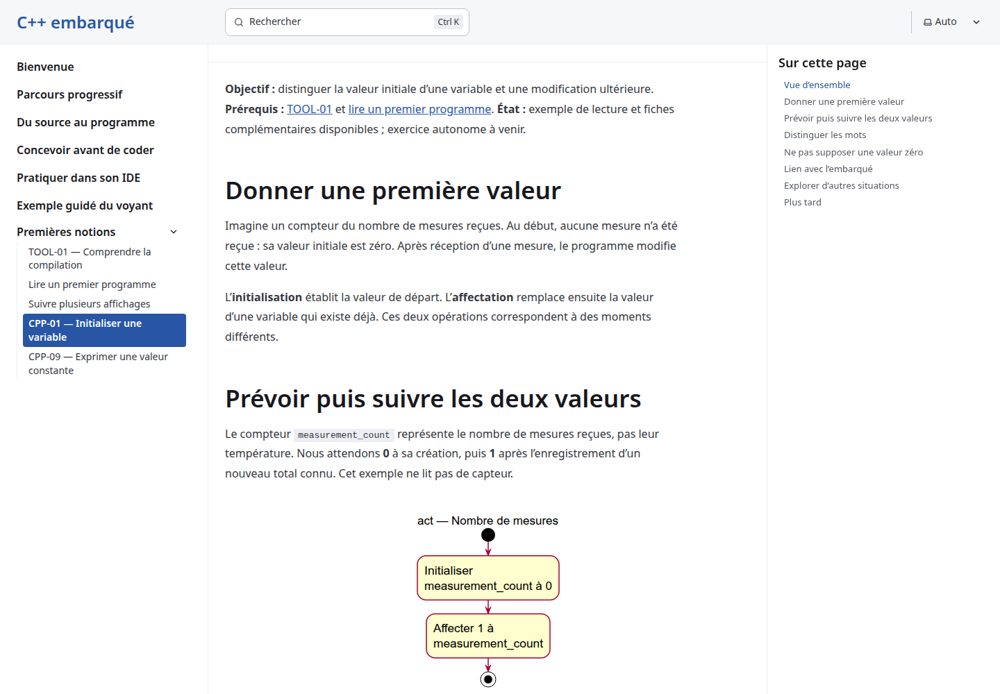
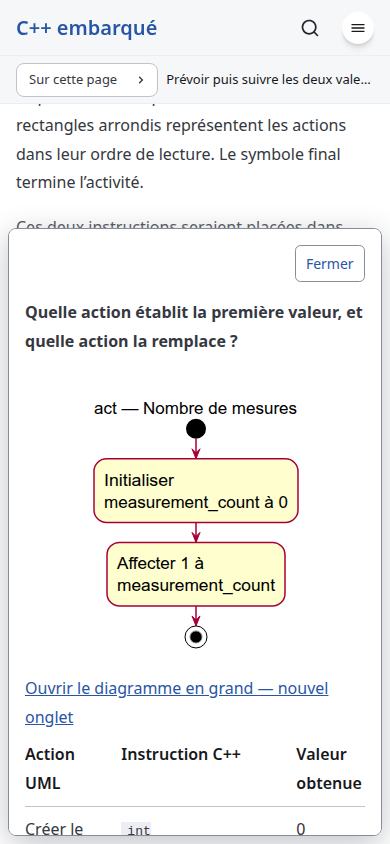

# Observable variables conception - local product smoke

Date: 2026-10-24. Issue: [#16](https://github.com/benoit-bremaud/cpp-learning-course/issues/16). Level: smoke, because this delivery adds engineering documents and a non-public conception diagram only. The public lesson, assets and runtime remain unchanged. Local production build only; no production or third-party host was probed.

## Scope and results

The existing production Playwright suite passes in installed Google Chrome, Firefox and WebKit at 1440px, 390px and 320px. Each engine reports zero captured page/console/HTTP errors and nine existing ordered-output diagram measurements. It also exercises cards and the companion explorer, keyboard/focus, outside/Escape/close dismissal, dark mode, reduced motion, reload, enlarged text and native fallbacks.

A direct Chrome check of local `/notions/cpp-01/` confirms the current primary two-action model, the two-instruction fragment and its native-enhanced card. The mobile card has its existing header plus two mapped action rows. This verifies stability, not the future five-action card. Console/network error listeners report zero errors. No newly discovered product finding was recorded in this smoke scope.

| Checklist area | Verdict | Evidence / scope |
| --- | --- | --- |
| Product starts and current reader path works | PASS | Fresh 12-page build, real production bundles |
| UI-02 console and network | PASS | Existing engine listeners and direct CPP-01 path report zero errors |
| Responsive and native card fallback smoke | PASS | Existing suite and the screenshots below |
| Full inspector review and performance trace | NOT RUN | Required for the later runtime implementation pass, not this docs-only smoke |
| SEC-01 through SEC-10 active probes | NOT RUN | No active security pass in this docs-only delivery; accepted implementation plan includes applicability verdicts under the rules of engagement |
| Broader domain checklist | NOT RUN | No runtime feature changed; smoke scope is explicit |

The full current regression suite was run in addition to this smoke evidence. No full WCAG, security-audit or assistive-technology conformance is claimed. Existing nonblocking build notices are recorded in the conception review; they are not new product findings.

## Screenshots

Raw engine artifacts: `/tmp/cpp-observable-conception-qa`. Accessibility and coverage diagnostics: ignored `coverage/` directory. Exact committed-head scanner and gate results are recorded with the publication review. No source/test/runtime changes were made to obtain these screenshots.
