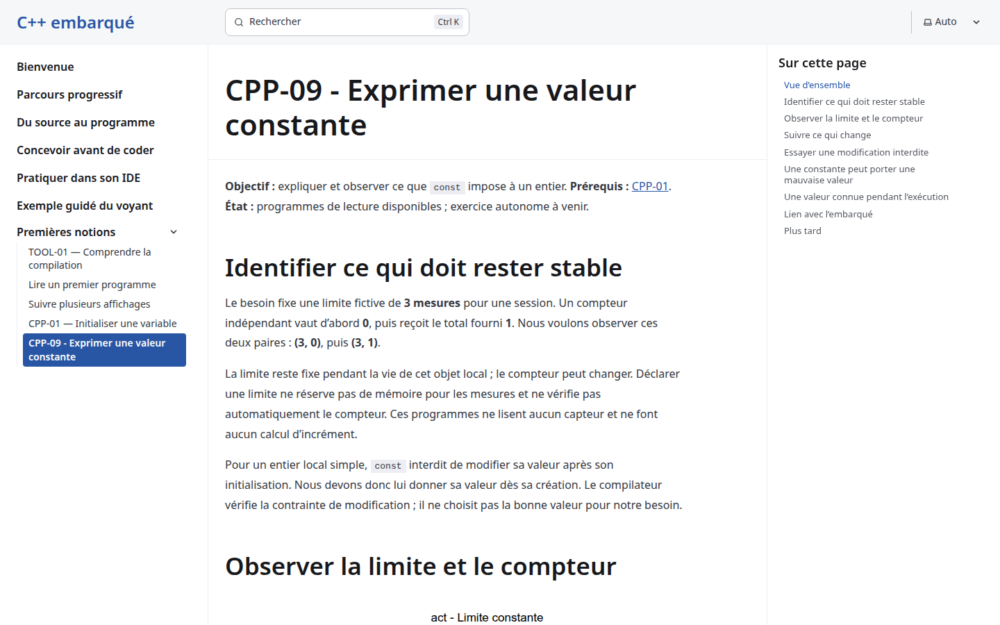
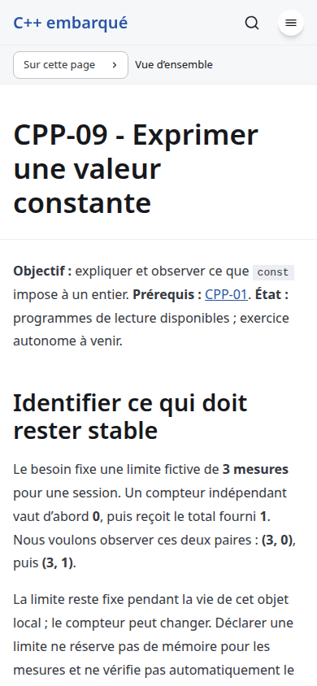

# Arithmetic-update conception - local product smoke

Date: 2026-10-26. Issue: [#23](https://github.com/benoit-bremaud/cpp-learning-course/issues/23). Level: smoke, documentation-only delivery. Local production build, loopback servers only. No production/third-party host was probed. The owner deferred a separate comprehensive QA campaign; this is routine delivery validation of the unchanged reader.

## Scope and verdicts

| Area | Verdict | Evidence / limits |
| --- | --- | --- |
| Product starts and existing reading path works | PASS | Fresh 12-page production build; existing three-engine regressions |
| Current cards, keyboard and focus restoration | PASS | All three current CPP-09 complete-source cards; rows 7/6/7 including header; Enter/Escape/focus at 1440x900 and 390x844 |
| Console and network smoke | PASS | Zero messages across all console levels, page errors, HTTP errors or failed requests in direct CPP-09 path |
| Responsive/theme/motion/fallback regression | PASS | Existing production Chrome/Firefox/WebKit suites, 320/390/768/1440, 200% text, native/no-JavaScript fallbacks |
| Automated accessibility regression | PASS | 28 axe scans, zero violations, unchanged incomplete-contrast diagnostic guard |
| New arithmetic route and programs | NOT RUN | Not implemented by this conception PR; exact specification sources are separate compiler studies |
| Full inspector, performance and SEC-01..10 active probe pass | NOT RUN | Docs-only smoke; future implementation records applicability and any new waiver separately |
| Comprehensive site QA | NOT RUN | Explicitly deferred by owner, not claimed complete |

No new product finding was identified in this smoke scope. No full WCAG, assistive-technology, security-audit or learner-effectiveness claim. No #20 preview-header waiver is inherited. Existing build/audit/tooling limitations are recorded in the conception review.

## Inspected screenshots

Both images show the current CPP-09 introduction and page context. They do not show a shipped arithmetic-update page or claim to expose its proposed program outputs. Both were visually inspected.

Raw smoke/engine artifacts: /tmp/cpp23-conception-qa. Logs: /tmp/cpp23-smoke.log and /tmp/cpp23-{chromium,firefox,webkit}.log. Source-mapped coverage/accessibility diagnostics remain in ignored coverage/. Exact committed-head Sonar evidence is recorded with publication review.
