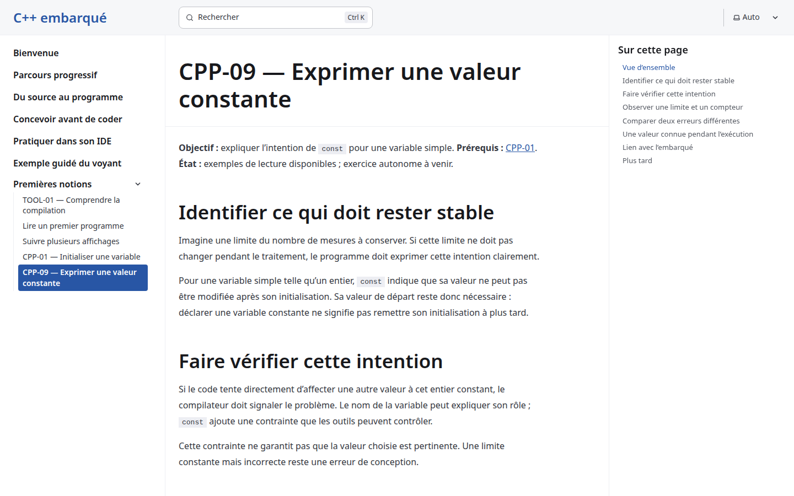
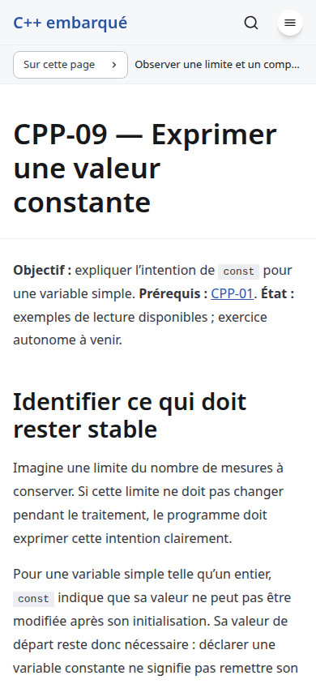

# Observable constants conception - local product smoke

Date: 2026-10-26. Issue: [#20](https://github.com/benoit-bremaud/cpp-learning-course/issues/20). Level: smoke. Engineering documents and non-public conception diagrams only; the published lesson/runtime are unchanged. Local production build, no external host probes.

The existing Chrome, Firefox and WebKit production regression suites pass. A direct Chrome visit to /notions/cpp-09/ checks all three current fragment cards with keyboard opening, Escape dismissal and focus restoration at desktop 1440x900 and mobile 390x844. Captured console messages, page errors, HTTP errors and failed requests are all zero.

| Area | Verdict | Evidence and limits |
| --- | --- | --- |
| Current product starts and reader works | PASS | Fresh production build and existing regression suites |
| Console/network smoke | PASS | Direct CPP-09 path, zero captured errors |
| Responsive/card smoke | PASS | Desktop/mobile and three-engine existing regression |
| Accessibility regression | PASS | 20 axe scans, zero violations; existing incomplete-contrast guard retained |
| Full inspector/performance review | NOT RUN | Required in the later implementation pass |
| SEC-01 through SEC-10 active probes | NOT RUN | Docs-only smoke; implementation must record applicability and any owner waiver separately |
| Broader domain checklist | NOT RUN | No runtime feature changed |

No new product finding was identified in this smoke scope. No full WCAG, assistive-technology or security-audit conformance is claimed. The #16 preview-header waiver is not reused for #20.

## Inspected screenshots

These images show the current CPP-09 introduction and existing page context, not the proposed complete programs or their execution results. Both images were visually inspected.

Raw smoke artifacts: /tmp/cpp20-conception-qa. Engine logs: /tmp/cpp20-chromium.log, /tmp/cpp20-firefox.log and /tmp/cpp20-webkit.log. Coverage/accessibility diagnostics remain in the ignored coverage directory.
